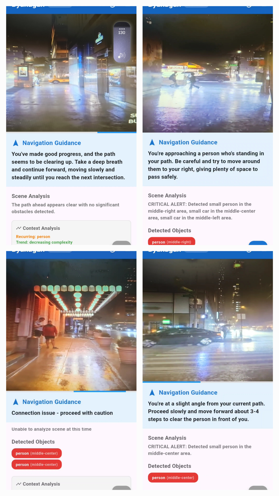

# Byakugan: AI-Powered Navigation for the Visually Impaired

[](LICENSE)
[](https://flutter.dev/)
[](https://flask.palletsprojects.com/)
[](https://docs.ultralytics.com/models/yolo-world/)
[](https://huggingface.co/meta-llama/Llama-3.2-3B)

**Byakugan** is an AI-driven, assistive navigation system designed to provide real-time, descriptive audio guidance for visually impaired individuals. By capturing live video frames from a mobile device and processing them through an edge-server AI pipeline, Byakugan translates complex visual scenes into empathetic, conversational, and actionable turn-by-turn obstacle avoidance instructions.

---

## Project Overview

Traditional navigation aids like white canes and guide dogs offer vital immediate physical paths and low-level obstacle detection, but they cannot read signs, describe layouts, or offer situational awareness. 

Rather than acting as a GPS route planner (like Google Maps), **Byakugan acts as an auditory "co-pilot"**. It focuses specifically on real-time **obstacle avoidance and scene understanding**, helping users avoid dynamic and static hazards while walking.

### Key Objectives
* **Open-Vocabulary Object Detection:** Identify unpredictable real-world hazards (e.g., curbs, low-hanging branches, puddles) dynamically.
* **Natural Conversational Guidance:** Utilize a lightweight Large Language Model (LLM) to translate raw spatial bounding box coordinates into casual, non-robotic verbal advice.
* **Low-Latency Edge Architecture:** Offload heavy model inference to an edge server to maintain sub-second response times while avoiding full cloud latencies.

---

## System Architecture

Byakugan operates on a hybrid architecture splitting client-side streaming/dictation and server-side vision & language reasoning:

```
+--------------------------+                +-------------------------------------------------+
| Mobile Client (Flutter)  |  HTTP Polling  |              Edge Server (Flask)                |
|                          |    (500ms)     |                                                 |
|  +--------------------+  | -------------> |  +-------------------+     +------------------+ |
|  |   Camera Module    |  |                |  | Object Detection  | --> |  Scene Builder   | |
|  +--------------------+  |                |  |  (YOLOv8-World)   |     +------------------+ |
|                           |                |  +-------------------+              |         |
|  +--------------------+  |                |                                      v         |
|  | Local Flutter TTS  |  | <------------- |  +-------------------+     +------------------+ |
|  +--------------------+  |    Response    |  | Response Builder  | <-- | LLM Guidance Engine|
|                          |    (JSON)      |  +-------------------+     |  (Llama 3.2 3B)  | |
+--------------------------+                +-------------------------------------------------+
                                                                                   ^
                                                                +------------------+
                                                                | Temporal Cache   |
                                                                | (Last 3 events)  |
                                                                +------------------+
```

1. **Mobile Application (Flutter):** Captures high-resolution frames and sends them via HTTP POST requests every 500ms. Audio guidance is synthesized using local device Text-to-Speech (TTS) to reduce bandwidth and latency.
2. **Edge Backend (Flask + Ollama/PyTorch):**
   * **Object Detector (YOLOv8-World):** Performs zero-shot open-vocabulary object detection.
   * **Scene & Temporal Context Builder:** Tracks spatial orientation and remembers a sliding memory window of the last 3 detection events to detect motion trends.
   * **LLM Prompter (Llama 3.2 3B):** Formulates contextual, safety-first navigation instructions.

---

## Performance & Evaluation Benchmarks

### 1. Object Detection Model Selection
Evaluating candidates from the YOLO series, **YOLOv8-World (s-v2)** was selected due to its **open-vocabulary** capability. Fixed-vocabulary models (like standard YOLOv8n or YOLOv9e) are limited to fixed COCO dataset categories (80 classes), missing daily critical outdoor hazards.

| Model | mAP (COCO val50-95) | Parameters | Speed (T4 TensorRT) | Feature / Architecture |
| :--- | :---: | :---: | :---: | :--- |
| YOLOv8n | 37.3 | 3.2M | 1.47 ms | Anchor-free, C2f module |
| **YOLOv8-World (s-v2)** | **37.7** | **~11M** | **~3–4 ms** | **Open-Vocabulary (RepVL-PAN)** |
| YOLOv9t | 38.3 | 2.0M | 2.30 ms | PGI, GELAN |
| YOLOv9e | 55.6 | 58.1M | 16.77 ms | High mAP, Fixed Vocabulary |

### 2. Large Language Model Selection
Small parameter models were evaluated for edge deployment. **Llama 3.2 3B** provided the optimal balance between reasoning accuracy (avoiding dangerous misdirections) and response generation speed.

| Model | Parameters | MMLU (5-shot) | GSM8K (8-shot) | Qualitative Score (1–5) |
| :--- | :---: | :---: | :---: | :---: |
| Gemma 3:1B | 1.23B | 49.3 | 44.4 | 3.5 |
| Qwen 3:4B | 4.00B | ~65.0 | ~75.0 | 4.0 |
| Llama 3.2:1B | 1.23B | 49.3 | 44.4 | 3.8 |
| **Llama 3.2:3B** | **3.21B** | **63.4** | **77.7** | **4.5** |

### 3. Real-World Scenario Testing

| Scenario | Avg Latency | Vision Accuracy | Narration Quality | Primary Challenges |
| :--- | :---: | :---: | :---: | :--- |
| **Daytime Outdoor** | ~650 ms | High | 4.5 / 5.0 | Glare, fast objects, motion blur |
| **Daytime Indoor** | ~620 ms | Very High | 4.7 / 5.0 | Reflective surfaces, transparent glass |
| **Crowded Environments** | ~800 ms | Medium | 3.0 / 5.0 | Object density, heavy occlusions |
| **Nighttime (Outdoor/Indoor)**| ~700–750 ms | Low | 2.0–2.5 / 5.0 | Low light noise, missed detections |

---

## Tech Stack

* **Frontend:** Flutter (Dart), Local Device TTS engine.
* **Backend Framework:** Python 3.x, Flask.
* **Vision Pipeline:** Ultralytics YOLOv8-World, PyTorch, OpenCV.
* **Language Model Engine:** Ollama / HuggingFace Transformers (Llama 3.2 3B).

---

## Getting Started

### Prerequisites
* **Python:** `^3.10`
* **Flutter SDK:** `^3.x`
* **NVIDIA GPU:** Recommended for real-time edge processing (CUDA enabled).
* **Ollama:** Installed and running on the backend host machine.

### Backend Setup

1. **Clone the repository:**
   ```bash
   git clone https://github.com/your-username/byakugan.git
   cd byakugan/backend
   ```

2. **Set up Python Virtual Environment:**
   ```bash
   python -m venv venv
   source venv/bin/activate  # On Windows: venv\Scripts\activate
   pip install -r requirements.txt
   ```

3. **Pull and serve Llama 3.2 3B via Ollama:**
   ```bash
   ollama pull llama3.2:3b
   ```

4. **Run the Flask server:**
   ```bash
   python app.py
   ```
   *The server will start listening on `http://0.0.0.0:5000`.*

### Frontend (Mobile App) Setup

1. **Navigate to the client folder:**
   ```bash
   cd ../mobile_app
   ```

2. **Install Flutter Dependencies:**
   ```bash
   flutter pub get
   ```

3. **Update Server IP:**
   Update the backend edge server endpoint IP in `lib/config/constants.dart`:
   ```dart
   // Hardcoded approach will be deprecated in implemented in the future versions
   const String BACKEND_URL = "http://<YOUR_EDGE_SERVER_IP>:5000/process_frame";
   ```

4. **Run the App:**
   ```bash
   flutter run
   ```

#### Screenshots



---

## Known Limitations & Disclaimers

* **Proof-of-Concept:** Byakugan is an academic project built for research purposes. It is **not** intended to replace certified primary mobility aids (canes, guide dogs).
* **Low Light Performance:** RGB-only vision models degrade severely in low-light/nighttime scenarios.
* **LLM Hallucinations:** Generative language models may occasionally hallucinate non-existent objects or misinterpret spatial attributes. Always exercise caution.

---

## Future Enhancements

* **Model Fine-Tuning:** Retrain YOLOv8-world specifically on custom datasets of assistive-navigation obstacles (e.g., drop-offs, construction barriers).
* **Depth & Hardware Integration:** Prototype custom wearable hardware (smart glasses) incorporating Time-of-Flight (ToF) LiDAR/depth sensors to overcome 2D camera limitations.
* **Hallucination Mitigation:** Implement strict structured verification guardrails between detection outputs and prompt generation.

---

## Authors & Acknowledgments

* **Jikesh Thapa**
* **Kevin Igweh**
* **Supervisor:** Dr. Md Al Maruf, PhD (School of Computer Science and Technology, Algoma University)
